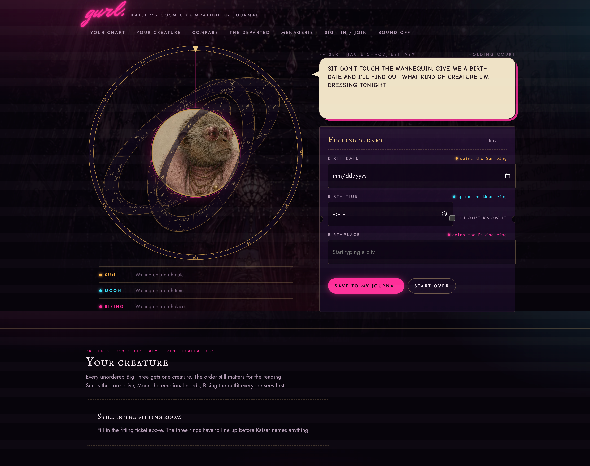

# gurl. ✦

### An astrology compatibility journal with personality.

**GURL** is a full-stack application for saving birth charts and exploring astrological compatibility, blending astronomical calculations, private accounts, and an illustrated interactive interface.

**Design, illustration, and development:** Michael Cosand

**[Try the live app](https://gurl.michaelcosand.com)**

## Preview




## Features

- **Birth charts:** Save Sun, Moon, and Rising signs when birth time is known.
- **Compatibility:** Compare charts with named people and receive a playful `gurl` to `guuuuurl` rating.
- **Private history:** Search, sort, rename, and delete saved comparisons.
- **Accounts:** Email/password authentication with persistent sessions using Better Auth.
- **Astronomy:** Astronomy Engine, Open-Meteo birthplace search, `geo-tz`, and Luxon.
- **Visual design:** Responsive layouts, animated zodiac wheels, and original illustrations.
- **Kaiser:** An original character from Michael Cosand's *Regular City* comic, featured in the center of the zodiac wheels.

## Tech stack

| Layer | Technology |
| --- | --- |
| Frontend | React, Vite, JavaScript, CSS |
| API | Node.js, Express |
| Database | PostgreSQL |
| Authentication | Better Auth |
| Calculations | Astronomy Engine, Luxon, geo-tz |
| Location search | Open-Meteo |
| Deployment | Ubuntu, Caddy, HTTPS |

## Astrology calculations

GURL uses tropical zodiac positions calculated from birth information. It computes geocentric Sun and Moon positions and determines the Ascendant when a birth time and location are available. Without a birth time, Rising is omitted and Moon is approximate, with uncertainty handling around sign transitions.

Scores are designed for entertainment and self-exploration, not to predict real-world relationship outcomes.

## Run locally

**Requirements:** Node.js 20.19+ (22 LTS recommended), PostgreSQL 15+, internet connection for city search.

1. Clone the repository:

   ```bash
   git clone https://github.com/ficklement/gurl.git
   cd gurl
   ```

2. Create a PostgreSQL database and dedicated local user.
3. Run `cp .env.example .env` (PowerShell: `Copy-Item .env.example .env`), then configure `DATABASE_URL` and `BETTER_AUTH_SECRET`. Generate a secret using `openssl rand -base64 32`.
4. Run `npm install`.
5. Initialize Better Auth: `npx auth@latest migrate --config ./server/src/auth.js`.
6. Initialize app tables: `npm run db:init`.
7. Start development: `npm run dev`, then open **http://localhost:5173**.

`localhost:5173` is Vite's development address, not the public website. `.env.example` uses port 3001 for the local backend; production uses separate configuration.

## API overview

| Route | Purpose |
| --- | --- |
| `GET /api/health` | Health check |
| `GET /api/places?q=Phoenix` | Authenticated birthplace search |
| `GET /api/chart`, `PUT /api/chart` | Personal birth chart |
| `GET /api/comparisons`, `POST /api/comparisons` | Saved comparisons |
| `PATCH /api/comparisons/:id`, `DELETE /api/comparisons/:id` | Modify or delete a comparison |
| `GET/POST /api/auth/*` | Better Auth |

## Kaiser and what's next

Kaiser already appears at the center of the animated zodiac wheels. Additional appearances, context-sensitive dialogue, and expressive layered animations are **planned features**, not yet completed.

GURL is actively developed. Planned improvements also include more astronomical edge-case validation, accessibility refinements, and ongoing security and privacy hardening.

User birth data and readings are private. Production secrets and records do not belong in this repository.

## Credits

**Michael Cosand:** design, illustration, and development  
**Live application:** https://gurl.michaelcosand.com  
**Repository:** https://github.com/ficklement/gurl
